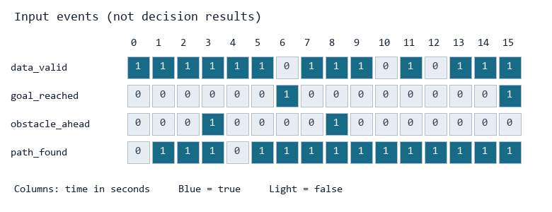

# 决策作业

**最终成果：** 读取一段模拟环境事件，输出等待、导航、请求重新规划、停止、到达等状态；数据短暂异常时立即停止，恢复后等待连续有效信息再行动。

## 作业素材

| 素材 | 内容 |
| --- | --- |
| [events_basic.json](materials/events_basic.json) | 等待路径、导航、到达 |
| [events_obstacle.json](materials/events_obstacle.json) | 遇障、等待新路径、恢复导航 |
| [events_fault.json](materials/events_fault.json) | 数据异常、短暂恢复、再次异常 |
| [events_combined.json](materials/events_combined.json) | 综合情况与条件冲突，用于最后一问 |



每个文件是按时间顺序排列的 JSON 数组，一条数据对应一个时刻；不需要实际等待。`id` 原样保留，`t_s` 为秒且递增，4 个状态字段是布尔值：

| 字段 | 含义 |
| --- | --- |
| `data_valid` | 本条环境信息是否有效 |
| `goal_reached` | 是否已经到达目标 |
| `obstacle_ahead` | 当前前进方向是否被障碍挡住 |
| `path_found` | 是否已有可用路径 |

`note` 仅帮助理解场景，程序不得使用作为判断依据；实际决策只能依据字段和前一状态。`REQUEST_REPLAN` 只表示发出请求，不能立即把输入中的 `path_found` 改成 true。

## 第一问：读取并检查事件

**输入：** `materials/events_basic.json`。

**要求：** 按输入顺序读出各事件，显示编号、时间和四个状态字段。了解一条环境数据如何变成程序中的对象。

**输出：** `outputs/q1/events.csv`，每条输入对应一行数据，另有表头。

**检查：** 顺序和字段值与输入一致，布尔值不能当作任意非空字符串处理。

## 第二问：根据条件选择当前状态

**输入：** 基础事件和遇障事件。

**要求：** 按下表从上到下判断，命中第一条就采用对应状态和动作：

| 优先级 | 条件 | state | action |
| --- | --- | --- | --- |
| 1 | 数据无效 | `STOP` | `STOP` |
| 2 | 已到达目标 | `ARRIVED` | `STOP` |
| 3 | 前方有障碍 | `REPLAN` | `REQUEST_REPLAN` |
| 4 | 没有可用路径 | `WAIT_PATH` | `STOP` |
| 5 | 其余情况 | `NAVIGATE` | `FOLLOW_PATH` |

**输出：** `outputs/q2/文件名_decisions.json`，数组中的每项包含 `id`、`t_s`、`state`、`action`、`reason`。`reason` 用一句话说明命中的条件。

示例：

```json
{"id": 0, "t_s": 0, "state": "WAIT_PATH", "action": "STOP", "reason": "没有可用路径"}
```

**检查：** 等待时不前进，遇障时请求重规划，到达后停止。前方有障碍与路径可用同时出现时，按优先级处理。

## 第三问：记录状态转换

**输入：** 遇障事件和第二问的决策程序。

**要求：** 保存前一状态，只有状态发生变化时才记录一条转换。每个输入文件单独运行，前一状态初始化为 `INIT`；第一条决策也要记录 `INIT` 到当前状态的转换。连续两帧同一状态不重复记录转换，但每帧决策仍然输出。

**输出：** `outputs/q3/decisions.json`、`transitions.json` 和一张状态转换示意图。转换记录包含 `id`、`t_s`、`from`、`to`、`reason`。

**检查：** 解释“每帧都有决策”与“只有变化才有转换记录”的区别。`REQUEST_REPLAN` 可以在连续受阻帧中重复出现，本题不要求实现导航模块或请求去重。

## 第四问：让故障恢复真正依赖历史

**输入：** `materials/events_fault.json`。

**要求：** 在前三问基础上增加以下规则：

1. 任意一条 `data_valid=false` 都立即进入 `STOP`，并将连续有效计数清零。
2. 故障后，第一条有效数据仍为 `STOP`，原因写“等待第二条连续有效数据”。
3. 第二条连续有效数据到来时解除故障等待，**同一条事件就重新按第二问规则判断**；再次出现无效数据则重新计数。
4. 第一次故障出现前，正常数据直接按第二问处理，不需要开机等待两条。

故障等待未解除时，即使其他字段显示已到达或路径可用，也保持 `STOP`。解除后仍需判断障碍等条件，不能直接强制进入导航。

**输出：** `outputs/q4/decisions.json` 和 `transitions.json`，格式沿用前面各问。

**检查：** 一条短暂有效数据不会立刻恢复前进；连续两条有效数据才恢复正常判断。报告说明这一步为什么不能只看当前事件的四个布尔值。

## 第五问：回放综合事件，解释完整过程

**输入：** `materials/events_combined.json`，使用第四问完成的同一个程序。

**要求：** 完整处理所有事件，并画出时间—状态变化图；横轴为 `t_s`，纵轴为状态，文字表格也可。每帧记录与状态转换记录分别保存。

**输出：** `outputs/q5/decisions.json`、`transitions.json`、`timeline.png` 或 `timeline.md`，以及报告中的简短过程说明。

**检查：** 重点说明数据无效与目标到达同时出现、前方障碍与路径可用同时出现、故障解除后仍然有障碍这三种情况。再复制素材并自改至少一条事件，保存新输入和实际输出，说明修改造成的变化。


## 提交与验收

将本仓库fork到自己的github账户下，在分支仓库中提交编写的源码、依赖说明、实际输出和填写后的 [REPORT.md](REPORT.md)。源码可以放在 `src/`，输出放在 `outputs/`。保留题目和原始素材，新增自己的实现。
